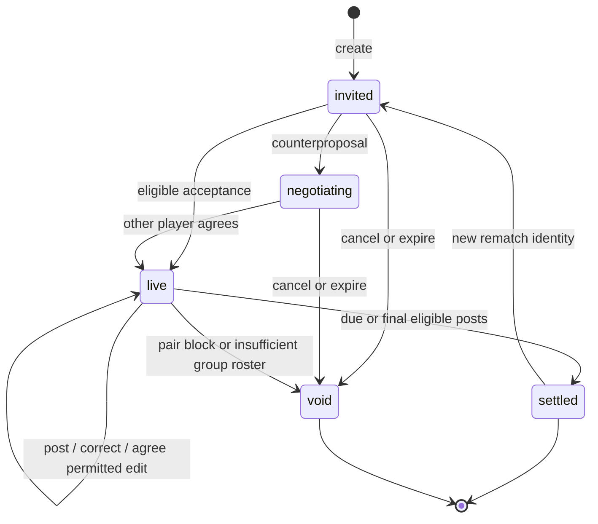

# Game self-play state map

Baseline: backend `ed361af347`, native iOS `40acb0d2`, November 9, 2026.
All players, posts, chat messages and database rows in this exercise are synthetic.
This is a reachable-state inventory and evidence ledger, not an exhaustive proof
over every combination of players, dates, network orderings and device state.

The [native scenario inventory](game-selfplay-scenarios.json) lists all 175 declared
Debug scenarios and 174 screen variants from the baseline, with explicit status
for the 63 variants exercised by the screenshot sweep. This complements the
runtime state coordinates below; a declared scenario is not proof of coverage.

## State coordinates

A game is not one enum. Its server lifecycle, proposal, each player's local day,
post attempt, delivery and native presentation move independently. Tests must
cross those boundaries instead of treating a screenshot as a completed journey.



| Coordinate | Reachable states | Required exits and invariants |
| --- | --- | --- |
| Server lifecycle | invited, negotiating, live, settled, void | Accepted current terms start play; settlement freezes the result; terminal games cannot accept posts. |
| Native phase | needsName, zero, waiting, negotiating, declined, beforeDayOne, playing, resultsSoon, recapReady, afterRecap, rematchRequested | A useful action or honest waiting state exists; closing a cover preserves the selected game. |
| Admission | signed out, unverified, allowed, denied, lookup failed | Retry and sign-out remain reachable; one account never sees another's pending work. |
| Schedule | before Day 1, scheduled day, off day, any-N target open/met, last day, grace window, due | Server calendar and player time zone own eligibility; the 3 AM boundary uses message occurrence time for chat corrections. |
| Proposal | absent, pending, applied, declined, cancelled, expired; queued/sent/retryable/terminal delivery | Pending terms do not replace accepted terms; exact other-player consent; expired changes cannot strand the game. |
| Post | empty, captured, unsaved, durable pending, sending, uncertain, Terms waiting, accepted, refused | One stable entry identity across retries; response loss cannot destroy a post; terminal refusal gives an exit. |
| Daily evidence | first post, retake, withdrawn, removed, incomplete, restored | Corrections preserve evidence; no third attempt; no post is invented by restoration. |
| Opponent visibility | none, locked, visible, loading, hidden, missed, off | Post-to-unlock remains server-owned; reporting hides content without rescoring. |
| Reply | closed, typing, permission, recording, review, durable pending, failed, accepted, refused | Draft survives failed handoff; exact target and account survive retries; deleting cannot race resurrection. |
| Prove it | available, confirmation, open, conceded, stood, void | One eligible case; withdrawal, departure and terminal games resolve it without native adjudication. |
| Recap | settling, writing, ready, playing, watched locally, watch receipt pending/acknowledged | Missing story has a truthful fallback; watching does not change the settled score. |
| Ticket | held, owed, redeemed, expired, void, acknowledgement owed | Only the holder can redeem; retry never sends another Messages handoff or spends another ticket. |
| Rematch | none, requested, changed, accepted, declined, superseded | Separate game identity; unrelated games with the same person are separate chains. |
| Device conditions | online, offline, interrupted, backgrounded, refreshed, relaunched | Accepted state cannot regress under delayed responses; durable pending work retains exact ownership. |

## Exploration rounds

| Round | Journeys | Evidence and status |
| --- | --- | --- |
| 1: native gameplay | setup, invite, daily home loop, missed completion, Prove it, recap, ticket, rematch | 124 selected UI tests on iOS 27.2 Pro Max: 121 passed, 3 failures investigated below. |
| 1: canonical rules | change agreement/retry, negotiation, incomplete/restored day, rematch | 60 focused tests passed, including real isolated PostgreSQL. |
| 1: assistant boundary | game tools and chat bootstrap | 59 deterministic tests passed. |
| 1: real assistant | prize proposal, contextual schedule approval, replacing counterproposal | Three GPT-6.1 Sol subscription journeys passed; effects and prose reviewed. |
| 1: composed self-play | both seats post; Maya changes prize; Sam agrees; locked-task refusal; incomplete then restored; settlement | Passed with real GPT-6.1 Sol, production prompts and canonical PostgreSQL operations; four permitted edits applied exactly once. Both seats’ seven Home snapshots decode and project correctly in native tests. |
| 1: asynchronous native state | post commits, newer Home arrives, older post response returns | Confirmed delayed post and reply snapshot regressions. Added red/green tests for opponent posts, incomplete correction, deletion, retake and overlapping Home reads; fixed at LiveGameService. |
| 2: visual/native recovery | daily and end states, agreement edits, storage failure, consent, blocking, compact actions | 63 screenshot scenarios passed on Pro Max; 23 UI tests passed on SE, including all five artifact storage failures and 21 bottom-action layouts. Hands-on simulator setup and backtracking passed. |
| 2: groups | canonical group lifecycle, membership, score and challenge boundaries | 166 isolated PostgreSQL tests passed; no claim of native group UI. |
| 3: artifacts and replies | photo unlock, rep tape, route, heart rate, replies, capture-mode changes | 57 tests passed on SE; 52 screenshot attachments captured, with representative reply, route and heart-rate states visually inspected. |

## Additional edge-case passes

The follow-up request added two passes over interruption and terminal boundaries:

- Pass 4: held post acknowledgements, lost responses, deletion/retake while a send
  remains in flight, access denial racing an older Home, first-Home recovery,
  replies, keyboard Return and screenshot variants. Reproduced the three follow-up
  defects above. Initial UI result: 14 of 15 tests passed; Return lost punctuation.
- Pass 5: calendar/DST and 3 AM boundaries, settlement, late recap, member deletion,
  small-phone recap/ticket/rematch exits and the repaired reply interactions.
  Canonical PostgreSQL/calendar proof: 132 tests passed. All 58 small-phone
  reply/recap/ticket/rematch UI tests passed after fixes. The Return regression
  also passed on Pro Max.

The reply comparison uses actual simulator captures in Paper; no layout redesign
is part of these fixes. The linked native PR carries the final screenshot evidence.

## Composed local reproduction

Use an isolated, migrated loopback database whose name begins `murph_test_`.
The deterministic run is the same canonical setup and mutations without a model:

```sh
MURPH_TEST_POSTGRES_CONCURRENCY=1 pnpm exec vitest run \
  --config apps/web/vitest.config.ts apps/web/test/game-selfplay-postgres.test.ts \
  --no-file-parallelism --no-coverage
```

Set `DATABASE_URL` to that local test database. Adding
`MURPH_SELFPLAY_REAL_MODEL=1` starts the focused real-Codex journey through the
normal local subscription runner, fixed to the requested `gpt-6.1-sol` model.
`MURPH_SELFPLAY_SNAPSHOTS` optionally names a local output directory for the
synthetic Home responses at each transition, for native decoder/projection proof.
Without a bridge, the composed assistant case skips in ordinary live-suite runs.
The bridge binds only loopback, chooses an ephemeral port, exposes only synthetic
read/update game tools and closes after the journey. Delivery providers are mocked.

## Reproduced native defects

1. A post committed, Home observed it plus an opponent post or chat correction,
   then the delayed POST response erased that newer state. The post outbox now
   retires when a server projection observes its exact entry identity. A late
   acknowledgement cannot replace later Home state or remove a newer pending post.
2. A subsequent deletion or retake on another phone could be undone by the same
   delayed response. Exact-entry retirement keeps the late send from merging,
   even when the current Home no longer contains the original entry.
3. An outgoing reply response could remove an opponent reply observed by Home.
   Existing server-observed reply retirement now prevents that stale merge.
4. Overlapping Home reads could return out of order. Started and accepted read
   sequences prevent older responses and non-auth failures from replacing an
   accepted newer read; a later-started explicit refresh still applies if an
   older background read finishes first. Command ordering remains separate.
5. Follow-up pass: a lost acknowledgement left a Home-confirmed post in the
   durable queue, showing retry or overlaying a later deletion. Home now retires
   it immediately from memory and disk; late errors cannot recreate that work.
6. Follow-up pass: a newer GAME_DISABLED response did not fence an older success,
   allowing it to reopen the game and overwrite the kept denial. Authoritative
   denial now advances accepted-read ordering as well.
7. Follow-up pass: Return could drop the final reply character when SwiftUI
   coalesced it with a newline. The reply field now keeps the newest text,
   separates pasted lines with spaces, and dismisses the keyboard.

Regression evidence lives in `GamePendingShotsTests`, `GamePendingRepliesTests`,
`GameServerMappingTests`, and the adjacent native Home/auth/safety tests. The
first two simple fixes were expanded only after inverse-order tests exposed
missing cases. Intermediate red runs are evidence, not final passing results.

## Human-facing visual checks

Computer use exercised empty Home, first-game instructions, typing an opponent,
relationship/frequency selection, a challenge, prize setup, backtracking, a custom
relationship, closing setup and the empty Prizes page. No trapped screen occurred.
Local screenshot bundles cover daily play, pending/failed changes, long text,
settlement and recap-writing fallbacks, rematches, reporting, blocking, posting,
and storage failures. Inspected examples preserve readable actions and exits;
compact-phone tests also assert action hitability above the keyboard and mode row.

The initial three UI failures are tracked separately from product defects:
- iOS 27 puts the system search-role New game action inside the tab bar. A test
  still required the iOS 26 separate circular frame. The screenshot shows distinct
  icons; the test now checks their order and actual tab navigation on iOS 27.
- Two setup failures followed synthetic coordinate taps inside the bounding union
  of wrapped text links. The input did not land on the token text. The harness
  now uses the link’s hittable point. Both failures pass with assertions unchanged;
  all 62 tests in the changed setup/navigation classes then passed on Pro Max,
  and both changed setup interactions also passed on SE.

Raw test bundles stay local under the native checkout’s ignored `build/qa`
directory. The follow-up reply fix has synthetic before/after captures in Paper;
its native PR includes the required final screen captures in that private repo.
No raw bundles or screenshot assets are published in this backend repository.

## Follow-up verification

- 136 native tests passed across pending shots/replies, access, block cache and
  reply composition. One additional adversarial retake test passed: a new post
  stays pending when the original acknowledgement arrives, then completes.
- The new retake fixture initially returned an impossible stale Home after its
  own successful commit; correcting that fixture produced green proof without
  another production change.
- Both native schemes built, project generation and source lint passed.
- PR CI exposed the existing account-deletion empty-table query-plan flake. A
  fresh analyzed database reproduced it. The test now analyzes a bounded synthetic
  event distribution and executes the original selector, asserting its actor/type
  index and two matching rows. All 26 account-deletion tests and Web typecheck
  passed after the fixture repair; production deletion behavior is unchanged.
- Independent review found no further concrete defect. No physical-device,
  production messaging or release-wide claims are inferred from these checks.

## Verification summary

- Final native ordering, outbox, Home, auth and safety regression batch: 142 tests passed.
- Final setup/navigation harness verification: 62 tests passed on Pro Max and
  two targeted wrapped-link interactions passed on SE.
- Native canonical snapshot mapping: both seats at seven transitions passed.
- Both native schemes built; project generation passed. Source lint passed with
  `swiftformat --lint . --exclude build` (the documented unqualified command
  incorrectly traverses downloaded dependencies; recorded as developer friction).
- Backend Web and assistant-engine typechecks passed; deterministic composed
  self-play rerun passed; JavaScript/TypeScript complexity diff passed.
- Independent native deep review found no remaining concrete issue in the final
  ordering design. Parent review checked the backend fixture bridge, opt-in
  boundary, native changes, synthetic data and coverage claims.
- Recovery and artifact/reply exploration rounds found no new confirmed product
  defects. This closes the exercised matrix, not every possible combination.
- Product UX result: Ready for the covered simulator journeys. Physical-device,
  delivery and release-wide gates remain separate.

## Findings and limitations

- Current native main renders pair games. Group backend support is staged and
  cannot be labelled native group gameplay coverage. Group admission remains a
  separate release/compatibility concern, not an inferred permission to redesign.
- Initial composed harness omitted the accepted message's occurrence timestamp.
  Murph correctly asked which date to correct. The harness now uses the production
  accepted-message prompt builder, including occurrence time; this was a harness
  defect, not a product defect.
- A five-turn model journey exceeded the ordinary 60-second Web-test deadline;
  this opt-in test now has its own finite deadline.
- UI prototypes prove native interaction; canonical service tests prove state
  transitions; real-model tool relays prove interpretation and canonical effects.
  These do not prove actual iMessage provider delivery or production runtime restart.
- Camera, GPS, Bluetooth and HealthKit simulations do not prove physical sensors.
  No production data or member-facing messages are used.
